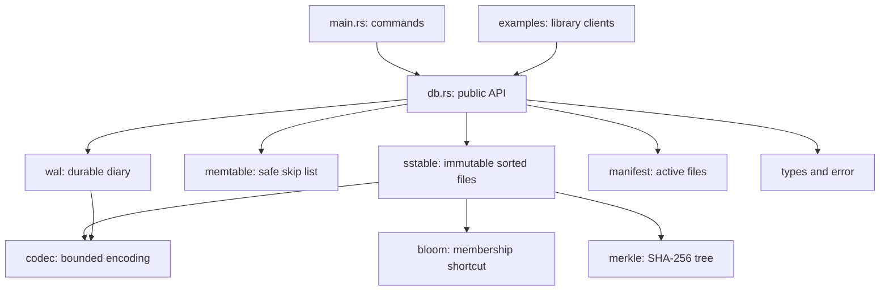

# Architecture

## Module boundaries



`lib.rs` exposes modules and public types. `main.rs` translates terminal input into library calls. No storage logic depends on Clap. Low-level modules are exposed for study and tests; applications should use `Db` to preserve locking, namespaces, durability, and uniqueness.

`main.rs` routes the `present` subcommand to `presentation/mod.rs`, which manages prompts and the session. `presentation/views.rs` formats verified snapshots, and `presentation/cases.rs` runs isolated edge-case exercises. `Db::enable_trace` opts into a per-handle event buffer; actual operations record their successful steps/lookup decisions and the menu drains the buffer after each action. Snapshot helpers expose read-only entries, skip-list levels, block metadata, and Merkle levels without changing the file format. Presentation checkpoints and copied tamper files live outside the active database directory.

## Write path

1. Validate input and reject a duplicate transaction ID.
2. Reserve `last_sequence + 1`, checking overflow.
3. Encode the entry and append its length-framed, CRC-protected WAL record.
4. Call `sync_all()` before publishing the record in memory or returning success.
5. Insert into the skip list. A newer sequence replaces an older mutable value.
6. Flush when estimated encoded bytes reach the configured threshold.

Every successful write is in a synced WAL or a durably published table. A write returning an I/O error may have partially or completely reached disk. The handle becomes poisoned; reopen before deciding whether to retry. Querying a financial transaction's unique ID helps resolve an uncertain outcome.

## Flush publication order

```text
WAL already synced
  -> write table temporary file -> sync file
  -> rename to final table -> sync database directory
  -> write new manifest temporary file -> sync file
  -> rename over MANIFEST.json -> sync database directory
  -> publish new in-memory table set
  -> truncate and sync WAL
```

The manifest is authoritative. Recovery ignores unfinished temporary files and unlisted orphan tables. If a crash leaves the old WAL after the new manifest committed, replay skips records at or below the persisted sequence. New writes continue from the next sequence.

## Recovery and locking

Opening obtains an exclusive OS lock, loads the manifest, and verifies each listed table's size and root. A missing manifest in a directory containing data is an error. Table entries are checked for valid namespaces and sequence bounds.

WAL replay bounds lengths before allocation, checks CRC and encoding, and requires increasing sequences. Only a physically incomplete final frame is discarded. Opening truncates that tail before another append. Complete records with wrong CRCs are never silently dropped. Unflushed records must continue the manifest sequence without a gap.

The OS releases `LOCK` on process exit or termination. The file remains; no stale lockfile deletion protocol is needed. Even read commands take this lock because opening can repair a torn WAL tail.

## Reads and scans

`get` checks the memtable, then tables newest first. A tombstone stops the search. Bloom filters can reject a table without reading a block. Binary search on the sparse index selects a candidate block. The reader authenticates its bytes against its leaf hash, decodes it, and binary-searches its entries.

Opening a table verifies its entire file and validates metadata, but retains only the index, Bloom filter, expected hashes, and path. Later lookups read the chosen block from disk. Restart is consequently more expensive than a lazy-validation design.

`scan` seeks bounded skip-list and SSTable streams, then heap-merges them while keeping the greatest sequence per key. It removes tombstones after resolving versions, excludes the financial namespace, and strips internal prefixes. Bounds are inclusive start and exclusive end in byte order. `scan_with_block_reads` also reports candidate data blocks actually read by the query; startup still verifies all tables. `transactions` uses a full `BTreeMap` merge and returns ledger records sorted by ID bytes, not timestamp.

## Compaction

Flush pending writes. Use one ordered iterator per active table and a min-heap (`BinaryHeap<Reverse<...>>`) to select the next key. Keep the greatest sequence among duplicates. Because every active table participates, tombstones can safely be removed.

Write the replacement table, commit a new manifest, then delete retired files and sync the directory. If everything was deleted, publish an empty table list but retain the last sequence. Interrupted cleanup may leave harmless unlisted files. Output is collected in memory before building the replacement table; this compactor does not have bounded memory use.

## Checkpoints

`checkpoint` flushes, verifies, and creates a new external JSON snapshot of the active manifest. It refuses existing output filenames and paths inside the database directory. Copy it to separately controlled storage.

`verify --checkpoint` checks current tables and WAL, requires exact manifest equality, and requires no unflushed entries. It proves equality to that snapshot, not append-only history across snapshots. Later legitimate writes or compaction change the snapshot too.

## Inclusion proofs and failure hooks

`transaction_proof` rejects pending transactions and selects the persisted table containing the requested ID. It exports the complete framed block and a Merkle sibling path. `TransactionProof::verify` authenticates that block against a table root selected from an independently trusted manifest/checkpoint and validates the requested receipt. The `verify-proof` CLI executes before database opening and works offline.

With the optional `fault-injection` feature, named hooks surround table/manifest publication. An injected error poisons the handle; an injected process exit skips destructors. Tests reopen each resulting store and check recovered scans, receipts, and proofs. Default builds do not invoke these hooks.

## Approximate costs

| Operation | Main cost |
| --- | --- |
| Skip-list lookup/insert | Expected O(log n) until the fixed 16-level cap matters; worst O(n) |
| Memtable iteration | O(n) |
| WAL append | O(record bytes) plus disk sync |
| SSTable build | O(total bytes + Bloom hashing), given sorted entries |
| Table open/full verify | O(file bytes), temporary memory proportional to file/decoded data |
| Single-table lookup | Bloom hashing + O(log blocks) index + one block read/decode/search |
| DB lookup | Memtable, then up to all active tables |
| Bounded scan | Skip-list/index seeks, candidate block decoding, and O(R log(T + 1)) merge for R matching entries across T tables plus memory; retains unique output and one decoded block per table |
| Heap merge | O(N log T) for T tables, plus output allocation/writing |

The memtable threshold counts encoded bytes, not allocator overhead. Its default is 1 MiB, configurable from 1 byte to 64 MiB. Compaction is explicit; there are no automatically maintained LSM levels.
